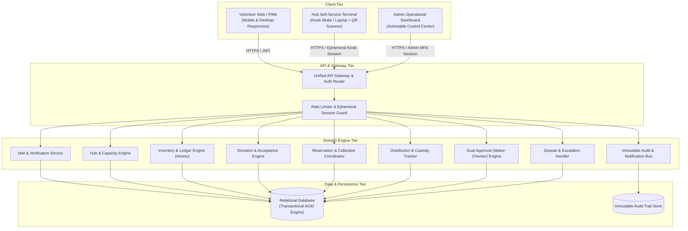
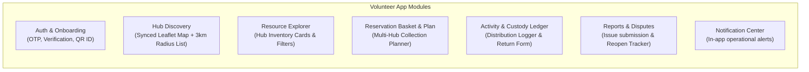
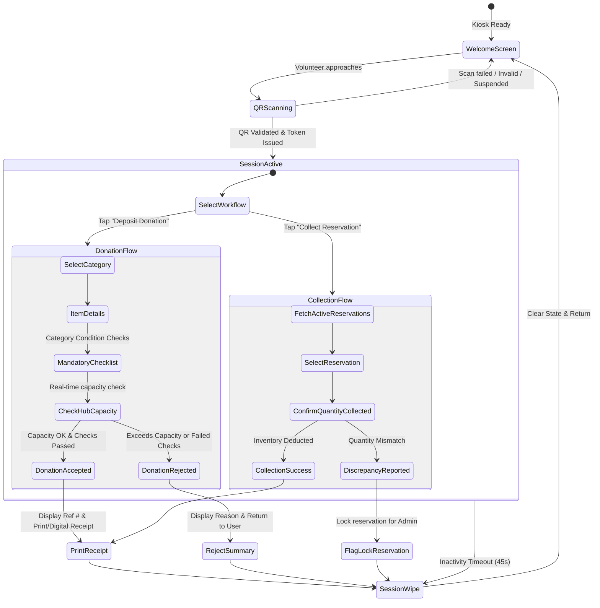
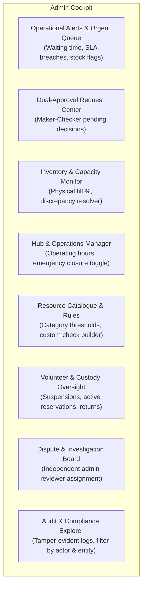
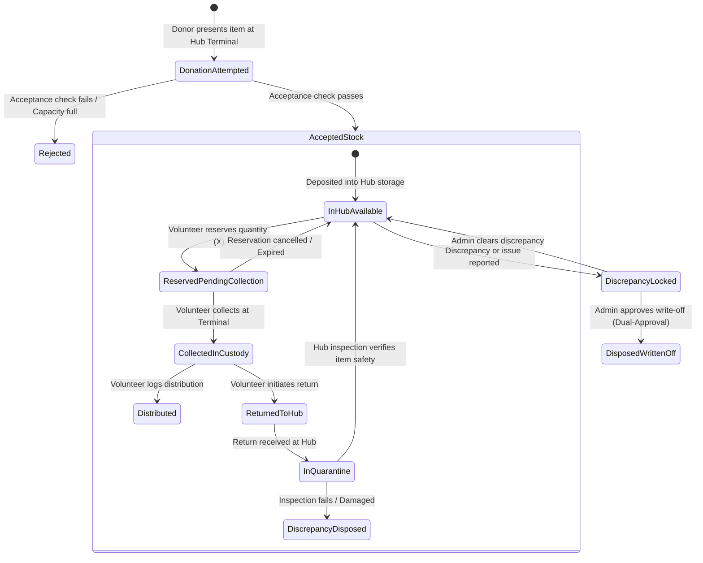
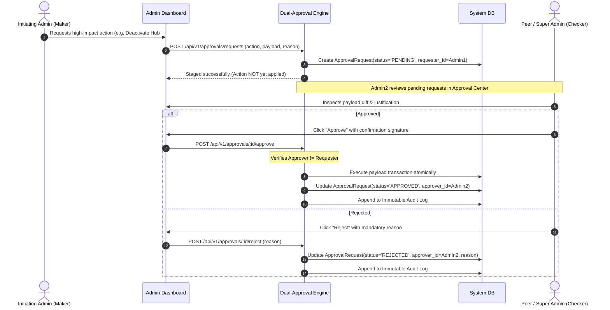

# JanaSeva — Application Architecture & Module Map v1.0

**Document Type:** Technical & Application Architecture Specification  
**Project Stage:** Architecture & System Design  
**Version:** 1.0  
**References:** [Product Blueprint v1.0](file:///c:/Desktop/MCA_Project/docs/PRODUCT_BLUEPRINT.md)  
**Primary Objective:** Translate the JanaSeva product blueprint into concrete system components, application boundaries, domain state engines, and a modular directory structure.

---

## 1. System Topology & Architectural Principles

JanaSeva employs a **Modular Monolith Architecture** with three specialized frontend applications consuming a unified, high-integrity backend API and transactional database.



### Core Architectural Principles

1. **Atomic Inventory Invariants**: Stock cannot be double-reserved, lost in transit, or over-collected. Inventory state changes occur within database transactions (`SERIALIZABLE` or strict row-level pessimistic locking).
2. **Ephemeral Kiosk Security**: The Hub Terminal persists zero volunteer identity tokens. A volunteer's QR code starts a short-lived, single-purpose session that is destroyed on timeout or completion.
3. **Dual Authorization (Maker-Checker)**: High-impact administrative actions (role modifications, permanent hub deactivations, catalogue modifications, major stock write-offs) are multi-step state machines requiring two distinct authorized admins.
4. **Non-Custodial Beneficiary Privacy**: Volunteers record distribution quantities and general geographic areas. No beneficiary biometric, facial, or identity data is collected or stored.
5. **Traceable Resource Lifecycle**: Every physical unit is tracked across distinct quantity buckets: *Available*, *Reserved*, *Collected*, *Distributed*, *Returned In Quarantine*, or *Discrepancy/Disputed*.

---

## 2. Application Boundaries & Module Breakdown

JanaSeva divides user interaction into three strictly isolated interfaces that share common domain models and validation rules.

### 2.1 Application 1: Volunteer Application (`apps/volunteer`)

**Target Devices:** Smartphone mobile browsers, tablet, desktop responsive web (PWA-ready).  
**Tone & UX:** Empowering, frictionless, community-centric, transparent.



#### Module Catalog:
- **`Auth & Onboarding Module`**:
  - Volunteer sign-up (Name, Phone/Email, City).
  - Contact channel verification via OTP.
  - Unique Volunteer ID generation and dynamic QR Code renderer.
  - Account recovery and phone/email update verification.
- **`Hub Discovery Module`**:
  - Live synchronized Dual View: Interactive Map (Leaflet/OSM) and sorting list.
  - Geo-filtering by 3 km radius, category availability, Hub type, and operating hours.
  - Real-time indicator for Hub operational status (`OPEN`, `TEMPORARILY_CLOSED`, `AT_CAPACITY`).
- **`Resource Catalog & Reservation Module`**:
  - Hub-specific inventory cards (Clothing sizes, Food shelf-life flags, Book genres).
  - Multi-Hub Collection Planner (aggregate reservations into one timed collection schedule).
  - Atomic reservation placement with countdown collection deadlines.
- **`Activity & Custody Ledger Module`**:
  - Active custody balance: `Quantity Collected - Quantity Distributed - Quantity Returned`.
  - Distribution logging (Resource type, quantity distributed, general locality, date/time, notes).
  - Return workflow (Initiation of return to a specific Hub for verification).
- **`Dispute & Support Module`**:
  - Issue reporting (Account, Resource quality, Hub discrepancy, General).
  - Dispute tracker with status: `SUBMITTED` &rarr; `UNDER_REVIEW` &rarr; `IN_PROGRESS` &rarr; `RESOLVED` &rarr; `CLOSED`.
  - Review / Reopening request mechanism with appeal reasoning.

---

### 2.2 Application 2: Hub Self-Service Terminal (`apps/terminal`)

**Target Devices:** Dedicated Hub laptop or kiosk touchscreen with front webcam and/or USB 2D barcode/QR scanner.  
**Tone & UX:** High-contrast, tactile, distraction-free, kiosk-hardened.



#### Key Architectural Controls:
1. **Zero Client-Side Identity Persistence**: No cookies, `localStorage`, or `sessionStorage` hold volunteer credentials across runs. Volunteer session state exists exclusively in a secure, memory-only state that self-destructs after 45 seconds of idle time.
2. **Strict Verification Flow**: The scanned QR code sends a temporary authentication handshake to `/api/v1/terminal/auth-qr`. The server validates volunteer account standing (`ACTIVE`), confirms no suspension, and returns a time-bounded ephemeral JWT (valid for 5 minutes maximum).
3. **Mandatory Acceptance Inspection UI**: Dynamic category forms present mandatory non-bypassable checkboxes (e.g., Food: "Expiry date is at least 48h away", "Sealed packaging intact", "Temperature check normal"; Clothing: "Washed & dry", "No severe tears/stains").
4. **Physical Capacity Guard**: Submitting a donation triggers an atomic check against `HubCategoryCapacity.current_units + new_units <= HubCategoryCapacity.max_units`. If exceeded, the UI immediately marks it `REJECTED_CAPACITY_EXCEEDED` and prompts the donor to retain the items.

---

### 2.3 Application 3: Admin Operational Dashboard (`apps/admin`)

**Target Devices:** Desktop / Laptop workstations (min 1280px width).  
**Tone & UX:** Dense, high-utility, actionable, operational command center.



#### Core Operational Sections:
1. **Actionable Overview & Urgent Alert Queue**:
   - Urgent banner with waiting-time counters (e.g., "Discrepancy at Hub Central: Unresolved for 42m").
   - Live system health: Physical capacity warnings (>85% full), pending 2nd approvals, overdue collections.
2. **Dual-Authorization Engine ("Maker-Checker")**:
   - Any sensitive change (Admin role update, permanent Hub deactivation, catalogue acceptance rule change, inventory manual write-off) enters a `PENDING_APPROVAL` queue.
   - Enforces `Requester_Admin_ID != Approver_Admin_ID`. Approvers must provide approval notes or structured rejection reasons.
3. **Inventory & Discrepancy Reconciliation**:
   - Live stock view by Hub and Category.
   - Quarantine bucket manager for items returned or reported damaged.
   - Discrepancy resolution tool: Locks reservations under investigation, requires verified physical audit before stock adjustment.
4. **Hub Administration & Closure Workflows**:
   - Capabilities configuration (Which categories a Hub can accept).
   - Capacity quotas per category (physical item count / volume threshold).
   - Temporary vs Permanent Closure toggles (Temporary closure notifies active reservation holders and freezes deadlines rather than cancelling them silently).
5. **Audit Explorer**:
   - Immutable timeline of all system events. Searchable by Actor, Action Type, Target ID, Date Range.

---

## 3. Core Domain Engines & Business Logic

### 3.1 Inventory State Machine & Quantity Model

A single status string (like `available` or `reserved`) cannot represent partial quantity lifecycles. JanaSeva models resource inventory as an **Atomic Multi-Bucket Quantity Model**:



#### Quantity Equation per Resource Item Batch:
$$\text{Total Quantity} = Q_{\text{Available}} + Q_{\text{Reserved}} + Q_{\text{InCustody}} + Q_{\text{Distributed}} + Q_{\text{Quarantine}} + Q_{\text{WrittenOff}}$$

- **Hub Capacity Rule**:  
  $$\text{Current Physical Hub Load} = \sum (Q_{\text{Available}} + Q_{\text{Reserved}} + Q_{\text{Quarantine}}) \le \text{Max Category Capacity}$$
  *(Notice that reserved items still consume physical Hub capacity until actually collected).*

---

### 3.2 Dual-Authorization Engine (Maker-Checker Workflow)

To prevent rogue admin actions or accidental system-wide disruptions:



---

### 3.3 Dispute Resolution & Independent Review

1. A volunteer submits a dispute regarding an account action or resource rejection.
2. The system checks the `actor_id` of the admin who made the original decision.
3. The dispute is queued for review by an admin where `evaluator_id != original_decision_actor_id`.
4. If no independent standard admin is available, the dispute automatically escalates to the `Super Admin` pool.
5. All revisions, evidence attachments, and communication threads are immutably archived.

---

## 4. Database Schema Blueprint (Relational Entity Map)

```mermaid
erDiagram
    VOLUNTEERS ||--o{ DONATION_ATTEMPTS : deposits
    VOLUNTEERS ||--o{ RESERVATIONS : books
    VOLUNTEERS ||--o{ DISTRIBUTIONS : records
    VOLUNTEERS ||--o{ REPORTS : files
    
    HUBS ||--o{ HUB_CAPACITIES : configures
    HUBS ||--o{ INVENTORY_ITEMS : stores
    HUBS ||--o{ RESERVATIONS : hosts
    
    RESOURCE_CATEGORIES ||--o{ HUB_CAPACITIES : categorized_by
    RESOURCE_CATEGORIES ||--o{ INVENTORY_ITEMS : classifies
    RESOURCE_CATEGORIES ||--o{ ACCEPTANCE_RULES : enforces
    
    RESERVATIONS ||--o{ COLLECTION_TRANSACTIONS : completes
    
    ADMINS ||--o{ APPROVAL_REQUESTS : initiates
    ADMINS ||--o{ APPROVAL_REQUESTS : approves
    ADMINS ||--o{ AUDIT_LOGS : generates

    VOLUNTEERS {
        uuid id PK
        string volunteer_code UK "e.g. V-8921"
        string full_name
        string email
        string phone
        string status "ACTIVE, SUSPENDED, DEACTIVATED"
        boolean contact_verified
        string qr_secret_salt
        timestamp created_at
    }

    HUBS {
        uuid id PK
        string hub_code UK "e.g. HUB-BLR-01"
        string name
        string hub_type "COMMUNITY_POINT, DEDICATED_CENTER"
        decimal latitude
        decimal longitude
        string address
        string operating_hours_json
        string status "ACTIVE, TEMPORARILY_CLOSED, DEACTIVATED"
        timestamp created_at
    }

    HUB_CAPACITIES {
        uuid id PK
        uuid hub_id FK
        uuid category_id FK
        integer max_units
        integer current_physical_units
        timestamp updated_at
    }

    RESOURCE_CATEGORIES {
        uuid id PK
        string code UK "CLOTHING, FOOD, BOOKS, TOYS"
        string name
        boolean is_active
        integer default_reservation_expiry_hours
        jsonb validation_rules_json
    }

    INVENTORY_ITEMS {
        uuid id PK
        uuid hub_id FK
        uuid category_id FK
        string item_name
        integer qty_available
        integer qty_reserved
        integer qty_in_custody
        integer qty_distributed
        integer qty_quarantined
        string condition_grade
        timestamp expiry_date
        string safety_status "PASSED, QUARANTINED, DISPOSED"
    }

    RESERVATIONS {
        uuid id PK
        string reservation_code UK "e.g. RES-4412"
        uuid volunteer_id FK
        uuid hub_id FK
        uuid item_id FK
        integer reserved_quantity
        string status "PENDING, COLLECTED, EXPIRED, CANCELLED, BLOCKED"
        timestamp expires_at
        timestamp collected_at
    }

    COLLECTION_TRANSACTIONS {
        uuid id PK
        string transaction_code UK
        uuid reservation_id FK
        uuid hub_id FK
        uuid volunteer_id FK
        integer quantity_collected
        timestamp timestamp
        string terminal_device_id
    }

    DISTRIBUTIONS {
        uuid id PK
        uuid volunteer_id FK
        uuid item_id FK
        integer quantity_distributed
        string general_location
        timestamp distribution_date
        string notes
    }

    APPROVAL_REQUESTS {
        uuid id PK
        string action_type "ROLE_CHANGE, HUB_DEACTIVATION, INVENTORY_WRITE_OFF, CATALOGUE_RULE"
        jsonb proposed_payload
        uuid requested_by FK
        uuid reviewed_by FK
        string status "PENDING, APPROVED, REJECTED"
        string rejection_reason
        timestamp created_at
        timestamp resolved_at
    }

    AUDIT_LOGS {
        uuid id PK
        timestamp timestamp
        string actor_type "VOLUNTEER, ADMIN, TERMINAL, SYSTEM"
        uuid actor_id
        string action
        string target_entity
        uuid target_id
        jsonb changes_json
        string ip_hash
    }
```



---

## 5. Technology Stack & Implementation Framework

Following the development guidelines:
- **Client Architecture**: Clean, modular Single-Page Application (SPA) / Progressive Web App (PWA) structured with **HTML5, modern Vanilla CSS, and modern JavaScript / React**.
- **Aesthetic System**:
  - Dark/Light mode theme system with rich custom HSL color tokens.
  - Glassmorphic panels, subtle backdrop-filter blurs, crisp micro-interactions.
  - Modern typography: Inter / Outfit via Google Fonts.
  - Interactive Map: Leaflet.js with OpenStreetMap (lightweight, responsive, zero-API-key overhead).
  - QR Code Scanner: `html5-qrcode` library for webcam and video stream decoding, with manual entry fallback.
- **Backend & Data Simulation / Real Engine**:
  - Express.js / Node.js API with modular route handlers and transactional state storage (e.g. SQLite / PostgreSQL with ACID guarantees, and an in-memory test harness).
  - End-to-end type safety and schema validation.

---

## 6. Directory Structure & Monorepo Organization

```text
c:\Desktop\MCA_Project\
├── docs/
│   ├── PRODUCT_BLUEPRINT.md               # Product Requirements Blueprint v1.0
│   ├── APPLICATION_ARCHITECTURE.md        # This specification
│   ├── SCREEN_BLUEPRINTS.md               # Screen-by-Screen specification
│   └── DESIGN_SYSTEM.md                   # Tokens, components, visual design
│
├── apps/
│   ├── volunteer/                         # Volunteer Application (PWA / Responsive)
│   │   ├── index.html
│   │   ├── src/
│   │   │   ├── components/                # MapView, HubCard, ReservationBasket, ActivityLedger
│   │   │   ├── pages/                     # Dashboard, Explore, Donate, Reservations, Activities, Profile
│   │   │   ├── services/                  # api.js, auth.js, geo.js
│   │   │   ├── styles/                    # volunteer.css, tokens.css
│   │   │   └── main.js
│   │
│   ├── terminal/                          # Hub Self-Service Kiosk Terminal
│   │   ├── index.html
│   │   ├── src/
│   │   │   ├── components/                # QRScannerModal, CategoryChecklist, ReceiptCard
│   │   │   ├── pages/                     # WelcomeKiosk, SessionDashboard, DonateFlow, CollectFlow
│   │   │   ├── services/                  # kioskSession.js, hardwareScanner.js
│   │   │   ├── styles/                    # terminal.css (High contrast kiosk theme)
│   │   │   └── main.js
│   │
│   └── admin/                             # Admin Operational Command Dashboard
│       ├── index.html
│       ├── src/
│       │   ├── components/                # UrgentAlertQueue, DualApprovalModal, InventoryMatrix
│       │   ├── pages/                     # Overview, Hubs, Inventory, Volunteers, Approvals, Disputes, Audit
│       │   ├── services/                  # adminApi.js, permissions.js
│       │   ├── styles/                    # admin.css
│       │   └── main.js
│
├── server/                                # Unified Backend Engine
│   ├── src/
│   │   ├── controllers/                   # hubs, inventory, donations, reservations, approvals
│   │   ├── domain/                        # State machines (inventoryStateMachine.js, dualApproval.js)
│   │   ├── middleware/                    # auth, ephemeralSession, auditLogger, rateLimiter
│   │   ├── models/                        # In-memory / Database persistence repositories
│   │   ├── routes/                        # /api/v1/volunteer, /terminal, /admin
│   │   └── server.js
│
├── shared/                                # Shared Domain Logic & Design Tokens
│   ├── styles/
│   │   ├── design-tokens.css              # Central color palette, elevation, typography tokens
│   │   └── animations.css                 # Smooth transitions & micro-interactions
│   └── constants/                         # Categories, Status Enums, Error Codes
│
└── package.json                           # Root dependencies & unified dev scripts
```

---

## 7. Next Deliverables in Sequence

1. **Screen-by-Screen Blueprint & UI Component Specs** (`docs/SCREEN_BLUEPRINTS.md`):
   - Detailed wireframes, states (empty, loading, error, success), and interaction flows for all 3 applications.
2. **Visual Design System & Token Architecture** (`docs/DESIGN_SYSTEM.md`):
   - Palette specifications (Forest Green & Warm Saffron community tones, Slate/Graphite dark mode, glassmorphism standards), button variants, card designs, and accessibility guidelines.
3. **Interactive Prototype & Full Stack Implementation**:
   - Building the core system incrementally with verified tests and live browser validation.
