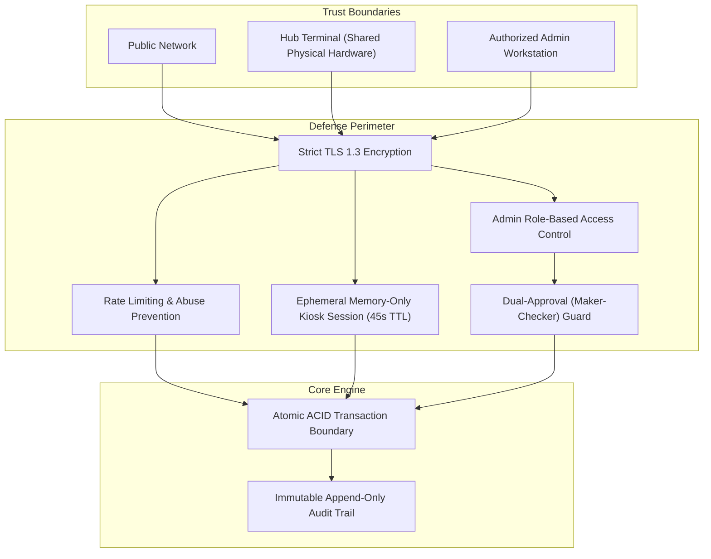
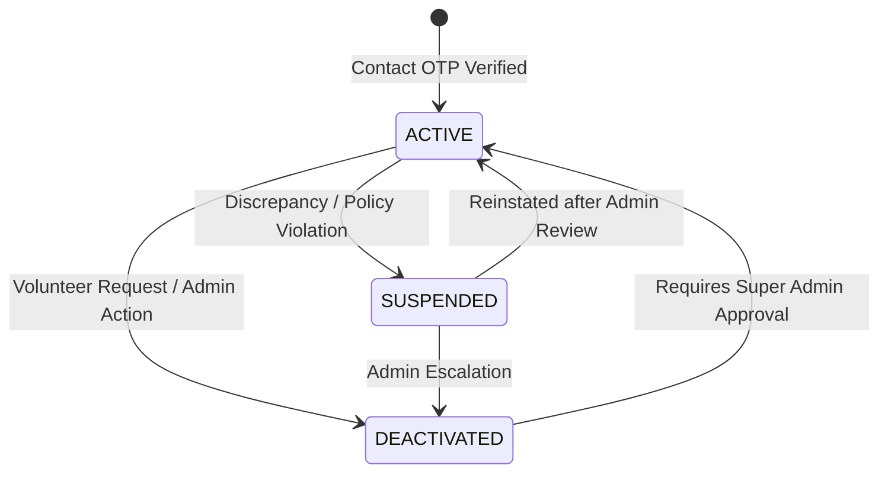
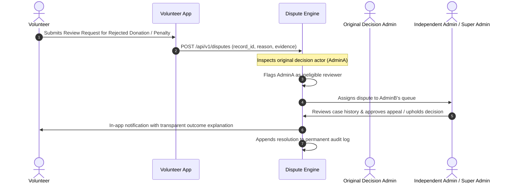

# JanaSeva — Security, Permissions & Workflows Specification v1.0

**Document:** 05 — Security, Permissions & Workflows  
**Version:** 1.0  
**Status:** Core Security & Governance Specification  
**Depends on:** [Product Blueprint v1.0](file:///c:/Desktop/MCA_Project/docs/product-blueprint.md), [Application Architecture v1.0](file:///c:/Desktop/MCA_Project/docs/application-architecture.md)

---

## 1. Security Architecture & Threat Model

JanaSeva protects community resources, volunteer identities, and physical inventory through defense-in-depth principles.



---

## 2. Volunteer Identity & Authentication Security

### 2.1 Contact Channel Verification
- Public registration creates volunteer accounts only.
- Phone or Email verification via time-bounded 6-digit One-Time Password (OTP) (5-minute expiry, max 3 attempts).
- Contact verification proves control of the communication channel; it does not collect invasive government ID credentials.

### 2.2 Volunteer ID & Dynamic QR Code Generation
- Each volunteer is assigned a permanent alphanumeric code (e.g., `V-8921`).
- The QR code displayed on the volunteer's mobile app contains a signed, time-salted token:
  $$\text{Payload} = \text{HMAC-SHA256}(\text{volunteer\_id} + \text{daily\_epoch}, \text{SECRET\_SALT})$$
- Prevents replay attacks from static screenshots taken weeks prior.
- If a mobile screen is damaged, the volunteer can enter their numeric `V-8921` code at the Hub Terminal alongside secondary verification.

### 2.3 Account State Transitions & Reservation Safeguards


- **On Suspension**:
  - The volunteer cannot make new reservations or initiate donations.
  - All **eligible uncollected reservations** are cancelled immediately and their quantities atomically released back to Hub available inventory.
  - Prior distribution history and dispute records are preserved for auditing.
- **On Deactivation**:
  - Uncollected reservations are cancelled immediately.
  - Items already collected into physical custody remain recorded; their return or verified disposition must be completed through a recorded administrative review.
  - Push notifications stop, but historical activity and security records remain immutable.

---

## 3. Hub Terminal Kiosk Security

The Hub Terminal operates in community centers without a dedicated security guard, requiring strict zero-trust technical controls:

1. **Ephemeral Memory-Only Sessions**:
   - Scanning a QR code creates an ephemeral session token with a **45-second inactivity timeout**.
   - No volunteer tokens, user IDs, or reservation records are persisted to `localStorage`, `sessionStorage`, or browser cookies.
   - When the session ends, all JavaScript state variables are explicitly zeroed out (`sessionState = null`).
2. **Dedicated Terminal Device Authentication**:
   - Each Hub Terminal laptop is provisioned with a secure hardware device key (`X-Hub-Device-Token`) tied to the specific physical Hub ID.
   - A terminal cannot initiate transactions for any Hub other than its assigned location.
3. **Strict No-Offline Transaction Mode**:
   - All donation deposits, acceptance checks, capacity queries, and collection confirmations require real-time backend verification.
   - If network connectivity fails, the terminal displays an explicit "Network Unavailable" screen and prevents unverified inventory modifications.

---

## 4. Multi-Bucket Inventory Integrity & Invariants

To eliminate stock drift, race conditions, and ghost reservations, resource inventory is modeled as an atomic state machine:

### 4.1 Invariant Rules
1. **Capacity Invariant**:
   $$\text{Hub Physical Units} = Q_{\text{Available}} + Q_{\text{Reserved}} + Q_{\text{Quarantine}} \le \text{Max Category Capacity}$$
2. **Conservation Invariant**:
   $$\text{Batch Total} = Q_{\text{Available}} + Q_{\text{Reserved}} + Q_{\text{InCustody}} + Q_{\text{Distributed}} + Q_{\text{Quarantine}} + Q_{\text{Discrepancy}} + Q_{\text{Disposed}}$$
3. **Atomic Decrement**:
   - Placing a reservation executes:
     ```sql
     UPDATE inventory_items 
     SET qty_available = qty_available - :qty,
         qty_reserved = qty_reserved + :qty
     WHERE id = :item_id AND qty_available >= :qty;
     ```
   - If row count affected is 0, the transaction aborts and returns an `OUT_OF_STOCK` error.

---

## 5. Dual Authorization ("Maker-Checker") Engine

High-impact administrative actions cannot be executed unilaterally by a single administrator.

### 5.1 Actions Requiring Second Approval
1. **Admin Role & Permission Modifications**: Elevating any user to Super Admin or altering permissions.
2. **Permanent Hub Deactivation**: Removing a Hub from the active community network.
3. **Major Inventory Adjustments**: Writing off or disposing of stock batches exceeding configured unit thresholds.
4. **Catalogue Rule Alterations**: Disabling categories or modifying mandatory health and safety condition checks.
5. **System Security Policies**: Changing session timeout limits or reservation countdown durations.

### 5.2 Enforcement Rules
- **Rule 1 (`Requester != Approver`)**: The database enforces `request.created_by != approval.actioned_by`.
- **Rule 2 (Mandatory Rejection Rationale)**: Any rejected request must include a structured text justification.
- **Rule 3 (Immutable Audit Trail)**: Both the initial proposed payload diff and the checker's signed approval are permanently recorded in the audit log.

---

## 6. Dispute Resolution & Independent Review Workflow



- Volunteers can request a review or reopening of any administrative decision.
- The system automatically blocks the administrator who made the original decision from acting as the independent reviewer of the dispute.
- If no independent operational admin is available, the request automatically escalates to a Super Admin.

---

## 7. Non-Custodial Beneficiary Privacy

JanaSeva's mission is to redistribute resources safely without subjecting beneficiaries to surveillance or invasive data collection:

- **No Beneficiary Biometrics or Photos**: Volunteers are explicitly prohibited from uploading recipient photographs or facial biometric captures.
- **Macro Distribution Recording**: Distribution records only require:
  - Resource item and verified quantity distributed.
  - Date and approximate timestamp.
  - General locality (e.g., "Ward 112 / Shanti Nagar Community").
  - Optional operational notes.
- This protects beneficiary dignity while ensuring reliable quantity reconciliation ($Q_{\text{Collected}} - Q_{\text{Distributed}} = Q_{\text{Remaining}}$).

---

## 8. Immutable Audit Trail & Compliance

1. **Append-Only Event Store**: Audit records are stored in a dedicated, tamper-evident log table where `UPDATE` and `DELETE` operations are completely disabled at the database privilege level.
2. **Secret Redaction**: Passwords, OTP hashes, auth tokens, and session secrets are automatically scrubbed by logging middleware prior to log persistence.
3. **Lifetime Retention**: In compliance with the product blueprint, operational audit records are preserved for the lifetime of the platform.
